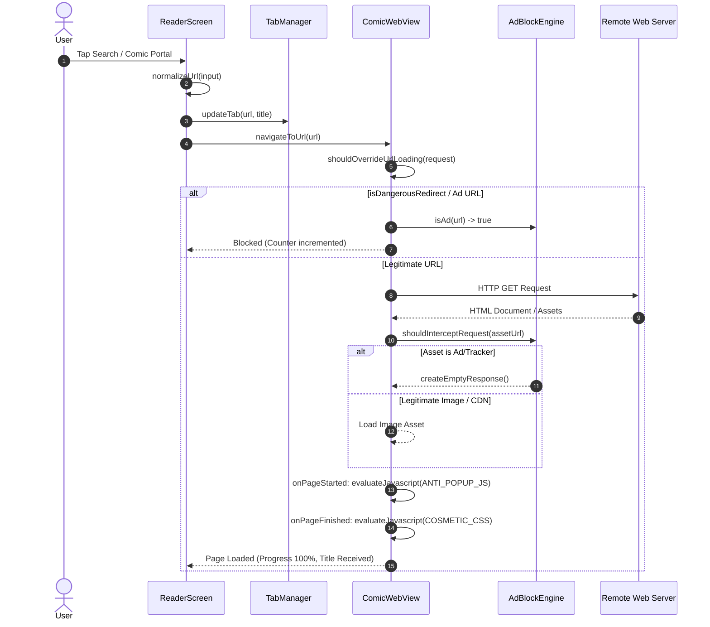

# Kuro Reader — Technical Specifications & Feature Documentation

> **Application Identifier:** `com.example.comicreader`  
> **Repository:** `7Manan7/comic_reader`  
> **Platform:** Android (Min SDK: 24 / Android 7.0, Target & Compile SDK: 36 / Android 16)  
> **Primary Language:** Kotlin 2.3+  
> **UI Architecture:** Jetpack Compose (Material 3) + Hardware-Accelerated WebView

---

## 📑 Table of Contents

1. [Executive Overview & Design Philosophy](#1-executive-overview--design-philosophy)
2. [Complete Feature Directory](#2-complete-feature-directory)
   - [2.1 High Refresh Rate Display Optimization (up to 165Hz+)](#21-high-refresh-rate-display-optimization-up-to-165hz)
   - [2.2 Multi-Tab Browsing Engine](#22-multi-tab-browsing-engine)
   - [2.3 Private & Incognito Browsing Mode](#23-private--incognito-browsing-mode)
   - [2.4 Kuro Shields Multi-List AdBlock & Security Engine](#24-kuro-shields-multi-list-adblock--security-engine)
   - [2.5 YouTube & Media Streaming Optimizer](#25-youtube--media-streaming-optimizer)
   - [2.6 Manga & Comic Touch Navigation](#26-manga--comic-touch-navigation)
   - [2.7 Dynamic Smart Fullscreen & Reading HUD](#27-dynamic-smart-fullscreen--reading-hud)
   - [2.8 Native Home Dashboard (`about:home`)](#28-native-home-dashboard-abouthome)
   - [2.9 Curated Manga & Manhwa Hub Directory](#29-curated-manga--manhwa-hub-directory)
   - [2.10 Multi-Engine Search Integration](#210-multi-engine-search-integration)
   - [2.11 Bookmarks & Custom Site Manager](#211-bookmarks--custom-site-manager)
   - [2.12 Comprehensive Browsing & Reading History](#212-comprehensive-browsing--reading-history)
   - [2.13 Night OLED / Dark Inversion Filter](#213-night-oled--dark-inversion-filter)
   - [2.14 Physical Hardware Volume Rocker Navigation](#214-physical-hardware-volume-rocker-navigation)
   - [2.15 Display & Comfort Settings](#215-display--comfort-settings)
   - [2.16 Unified Brave-Style Control Menu & UI Geometry](#216-unified-brave-style-control-menu--ui-geometry)
3. [System Architecture & Data Flow](#3-system-architecture--data-flow)
   - [3.1 High-Level Component Architecture](#31-high-level-component-architecture)
   - [3.2 Component Interaction & Navigation Flow](#32-component-interaction--navigation-flow)
4. [Deep-Dive Technical Implementation](#4-deep-dive-technical-implementation)
   - [4.1 Window & Insets Architecture (`MainActivity.kt`)](#41-window--insets-architecture-mainactivitykt)
   - [4.2 Display Refresh Rate Controller (`RefreshRateManager.kt`)](#42-display-refresh-rate-controller-refreshratemanagerkt)
   - [4.3 AdBlock Engine Internals (`AdBlockEngine.kt`)](#43-adblock-engine-internals-adblockenginekt)
   - [4.4 Multi-List Downloader & Parser (`AdBlockListManager.kt` & `EasyListParser.kt`)](#44-multi-list-downloader--parser-adblocklistmanagerkt--easylistparserkt)
   - [4.5 Hardware-Accelerated WebView Architecture (`ComicWebView.kt`)](#45-hardware-accelerated-webview-architecture-comicwebviewkt)
   - [4.6 YouTube Web Experience Optimizer (`YouTubeOptimizer.kt`)](#46-youtube-web-experience-optimizer-youtubeoptimizerkt)
   - [4.7 Tab Management & State Isolation (`TabManager.kt`, `Tab.kt`)](#47-tab-management--state-isolation-tabmanagerkt-tabkt)
   - [4.8 Unified App Settings & Storage (`AppPreferences.kt`, `SessionManager.kt`)](#48-unified-app-settings--storage-apppreferenceskt-sessionmanagerkt)
   - [4.9 Bookmarks & History Persistence (`BookmarkManager.kt`, `HistoryManager.kt`)](#49-bookmarks--history-persistence-bookmarkmanagerkt-historymanagerkt)
   - [4.10 Native Jetpack Compose UI Layer (`ReaderScreen.kt`, `HomeScreenContent.kt`)](#410-native-jetpack-compose-ui-layer-readerscreenkt-homescreencontentkt)
5. [Storage Formats & Serialization Specifications](#5-storage-formats--serialization-specifications)
6. [Security, Permissions & Network Model](#6-security-permissions--network-model)
7. [Dependencies, Build Configuration & Testing](#7-dependencies-build-configuration--testing)

---

## 1. Executive Overview & Design Philosophy

**Kuro Reader** is a high-performance Android browser engineered specifically for reading online comics, manga, manhwa, and webtoons. Standard web browsers (Chrome, Firefox, Samsung Internet) suffer from numerous drawbacks when reading comics:
- Aggressive redirect ads, popunders, and hidden transparent clickjack overlays that hijack reading sessions.
- Incompatible gesture systems that hijack swipe gestures intended for flipping comic pages.
- Frame rate drops and tearing caused by system refresh rates defaulting to 60Hz.
- UI elements (URL bars, navigation controls) consuming valuable vertical screen real estate.
- Lack of specialized manga navigation (volume key page flips, OLED invert for pitch-black rooms, instant manhwa hub launchpads).

Kuro Reader addresses these issues by pairing an ultra-lightweight, hardware-accelerated WebView engine with a multi-list AdBlock defense layer, direct native touch passthrough, hardware-locked high refresh rate modes (up to 165Hz+), and a Jetpack Compose Material 3 interface.

---

## 2. Complete Feature Directory

### 2.1 High Refresh Rate Display Optimization (up to 165Hz+)
- **Hardware-Level Rate Detection**: Queries Android's `Display.supportedModes` to retrieve all physically supported refresh rates for the attached display panel.
- **Window Display Mode Locking**: Overrides the window attributes (`preferredDisplayModeId` and `preferredRefreshRate`) to prevent Android OS dynamic refresh rate throttling, ensuring consistent, tear-free scrolling.
- **User-Selectable Rates**:
  - `Auto (Max)`: Automatically determines the highest available hardware rate (e.g., 120Hz, 144Hz, 165Hz) matching the panel's native resolution.
  - `165Hz`: Ultra-high refresh gaming panels.
  - `144Hz`: Premium flagship displays.
  - `120Hz`: Standard high-refresh OLED/AMOLED screens.
  - `60Hz`: Battery-saver mode for extended reading sessions.
- **Persistent Preferences**: Restores the selected target rate on app launch.

### 2.2 Multi-Tab Browsing Engine
- **In-Memory Tab Cache**: Maintains open tab WebViews in memory (`tabWebViews: MutableMap<String, ComicWebView>`) to allow instant tab switching without reloading or losing vertical reading progress.
- **Tab Capacity**: Manages up to 50 concurrent tabs with automatic LRU trimming.
- **Interactive Tab Switcher**:
  - Grid card view with live titles, source domain pills, and URL snippets.
  - Active tab highlighting with distinct blue/purple neon borders and `ACTIVE` status pills.
  - Individual tab close buttons (`✕`) and top-level action buttons: **Close All Tabs** and **Close All Private Tabs**.
- **Dynamic Tab Badge**: Displays the active tab count in the bottom bar with `99+` overflow support.
- **Contextual Link Handling**: Opens links in new background or foreground tabs via long-press / window creation events.

### 2.3 Private & Incognito Browsing Mode
- **Zero-Trace Privacy**:
  - Web cache completely disabled (`LOAD_NO_CACHE`).
  - Form data saving disabled (`saveFormData = false`).
  - Web history and form data purged on navigation.
  - Visited pages are never written to `HistoryManager` or `SessionManager`.
- **Session Isolation**: Incognito tabs are completely separated from standard browsing tabs.
- **Automatic Cold-Start Purge**: All private tabs are automatically deleted when the app is restarted.
- **Incognito UI Styling**:
  - Deep purple background tones (`#0F0B14`, `#130F1E`, `#261938`).
  - Distinctive mask icon badges (`🕶️`).
  - Dedicated Segmented Switcher in the tab manager to toggle between **Standard Tabs** and **Private Tabs**.
  - Empty-state private dashboard explaining privacy guarantees.

### 2.4 Kuro Shields Multi-List AdBlock & Security Engine
- **15 Filter Lists Across 4 Categories**:
  1. **Default (4/4)**:
     - `EasyList`: Global ad-blocking rules for banners, popups, and video overlays.
     - `EasyPrivacy`: Tracker, analytics, and telemetry blocking.
     - `Peter Lowe's List`: Authoritative hosts list of ad and tracking servers.
     - `uBlock filters – Ads, trackers, and more`: uBO-specific cosmetic circumventions and popunders.
  2. **Privacy (2/2)**:
     - `AdGuard/uBO URL Tracking Protection`: Removes query tracking parameters (`utm_*`, `fbclid`, `gclid`).
     - `Block Outsider Intrusion into LAN`: Prevents public web pages from probing `localhost` and local subnet devices.
  3. **Malware Protection & Security (2/2)**:
     - `uBlock filters – Badware risks`: Blocks scareware, fake virus alerts, and rogue APK download triggers.
     - `Malicious URL Blocklist (URLhaus)`: Real-time blacklist of exploit kit domains and malicious payloads.
  4. **Annoyances (7/7)**:
     - `EasyList – AI Widgets`: Blocks AI summaries and floating assist widgets.
     - `EasyList/uBO – Cookie Notices`: Removes GDPR/CCPA cookie consent dialogs.
     - `EasyList – Notifications`: Suppresses web push notification prompts.
     - `EasyList – Other Annoyances`: Page irritations, surveys, self-promos, and visual nags.
     - `EasyList/uBO – Overlay Notices`: Newsletter overlays, anti-adblock modals, and sign-up paywalls.
     - `EasyList – Social Widgets`: Social sharing buttons, follower counts, and comment widgets.
     - `EasyList – Chat Widgets`: Floating customer service chat bubbles and support popups.
- **Multi-Format Rule Parsing**: Handles Adblock Plus (`||domain^`, `@@` exceptions), Hosts (`127.0.0.1 domain`), and CSS cosmetic element-hiding (`##.banner`, `example.com##.ad`).
- **Concurrent List Updates**: Downloads and extracts GZIP-compressed filter lists in parallel via Kotlin coroutines with fallback mirror URLs.
- **Bundled Baseline Assets**: Ships with local baseline assets (`easylist_baseline.txt`, `easyprivacy_baseline.txt`, `peter_lowe_baseline.txt`, `urlhaus_baseline.txt`) for immediate out-of-the-box ad blocking without requiring network connectivity.
- **Anti-Popup & Anti-Redirect Safeguards**:
  - Early JavaScript injection (`ANTI_POPUP_JS`) at `onPageStarted` neutralizes rogue `window.open` calls.
  - Automatically sweeps transparent fullscreen clickjack overlays (`z-index >= 999`, opacity < 0.1).
  - Intercepts malicious external intent schemes (`intent:`, `market:`, `vnd.youtube:`, `itms-appss:`, `alipayqr:`).
- **First-Party Site Whitelist Safeguard**: Legitimate manga chapters, image CDNs, and same-domain subdomains are never blocked accidentally.
- **User Domain Whitelisting**: 1-tap whitelist switch in the Shield dialog and menu.

### 2.5 YouTube & Media Streaming Optimizer
- **Web App De-Cluttering**: Automatically hides "Open in YouTube App", "Get App", "Try YouTube Premium", and sticky app promo banners.
- **Automatic Ad Skipper**: Scans for standard skip buttons (`.ytp-ad-skip-button`) every 350ms and clicks them. For unskippable ads, fast-forwards video playback to 16x muted until the ad completes.
- **Native Double-Tap Seek**:
  - Double-tap left side of the video player: rewinds 10 seconds (`◀◀ 10s`).
  - Double-tap right side of the video player: fast-forwards 10 seconds (`10s ▶▶`).
  - Displays an animated ripple feedback badge.
- **HTML5 Fullscreen Video Overlay**: Intercepts `WebChromeClient.onShowCustomView` to provide full edge-to-edge landscape and portrait video playback.
- **Smart Video Wake-Lock**: Detects HTML5 video playback state through the `KuroBridge` JavaScript interface and keeps the screen awake automatically during video playback.
- **Clean User-Agent Identification**: Strips `Version/4.0` and `; wv` tokens from the user-agent string so YouTube serves full Chrome Mobile MSE (Media Source Extensions) streams.

### 2.6 Manga & Comic Touch Navigation
- **Native Touch Passthrough**: Horizontal touch events are forwarded directly to the web view. Embedded web readers (tap left/right edge to turn page, swipe to flip, horizontal panel panning, pinch-to-zoom) operate without interference.
- **Center-Zone HUD Toggle**: Single-tap in the center reading zone (`30%..70%` vertical, `20%..80%` horizontal) toggles the browser HUD. Taps on site navigation bars, search inputs, or links are passed to the webpage.
- **Native Gesture Back/Forward**: Supports Android edge-swipe back navigation and dedicated toolbar buttons (`◀` Back / `▶` Forward).

### 2.7 Dynamic Smart Fullscreen & Reading HUD
- **Default Browser Mode**: Launches with visible status bar, top navigation bar, and bottom action bar.
- **Scroll-Down Fullscreen**: Scrolling down 12px or more smoothly collapses top and bottom bars via `shrinkVertically()` and hides system status bars via `WindowInsetsControllerCompat`.
- **Scroll-Up Bar Restoration**: Scrolling up or returning to the top (scrollY <= 15) restores all bars instantly.
- **Non-Obscuring Layout**: The UI uses a `Column` layout so the top URL bar never covers web page headers or logos when visible.

### 2.8 Native Home Dashboard (`about:home`)
- **Modern Launchpad**: Replaces blank start tabs with a curated dashboard.
- **Integrated Multi-Engine Search Bar**: Real-time search engine switching with trending manhwa suggestion chips.
- **Quick-Access Bookmarks Grid**: Visual cards for pinned manga portals.
- **"Continue Reading" Carousel**: Displays recent chapters and reading history with timestamps.
- **Incognito Privacy Indicator**: Hero header dynamically adjusts between standard and private themes.

### 2.9 Curated Manga & Manhwa Hub Directory
Pre-configured, 1-tap shortcuts with custom brand color palettes:
1. **Asura Scans** (`asuracomic.net`): Action, solo leveling, and regression manhwa.
2. **Demonic Scans** (`demonicscans.org`): Martial arts & fast action releases.
3. **Flame Comics** (`flamecomics.xyz`): Trending Korean fantasy webtoons.
4. **Comix** (`comix.to`): Clean, high-speed reader with full-width webtoon view.
5. **MangaDex** (`mangadex.org`): Non-profit community hub with scanlation teams.
6. **MangaKatana** (`mangakatana.com`): Vast manga & manhwa archives.
7. **Webtoons** (`webtoons.com`): Official global webcomics platform.
8. **MangaFreak** (`ww3.mangafreak.me`): Daily chapter releases.
9. **ComicK** (`comick.io`): Modern manga tracking platform.
10. **MangaPark** (`mangapark.net`): Multi-source high-res aggregator.

Filterable by categories: `All`, `Top Manhwa`, `Cultivation`, `Webtoons`, and `Scanlations`. Each card features direct `Read ➔` and `+ New Tab` buttons.

### 2.10 Multi-Engine Search Integration
- **5 Search Providers**:
  - 🔍 **Google**: `https://www.google.com/search?q=`
  - 🦆 **DuckDuckGo**: `https://duckduckgo.com/?q=`
  - 🦁 **Brave Search**: `https://search.brave.com/search?q=`
  - 🌐 **Bing**: `https://www.bing.com/search?q=`
  - 🌱 **Ecosia**: `https://www.ecosia.org/search?q=`
- **Unified Address Bar Resolution**: Intelligently distinguishes between direct URLs (`domain.com`, `http://`, `https://`) and search queries, encoding queries with the selected search provider.

### 2.11 Bookmarks & Custom Site Manager
- **1-Tap Bookmarking**: Star/unstar pages directly from the top URL bar or menu.
- **Custom Site Addition**: Add custom reading sites with title, URL, and custom emoji icon.
- **Dedicated Bookmarks Sheet**: Manage, open, and delete saved bookmarks.
- **Persistent Storage**: Saved in `SharedPreferences` (`comic_reader_bookmarks`).

### 2.12 Comprehensive Browsing & Reading History
- **Automatic History Recording**: Logs page title, URL, and timestamp (suppressed in Incognito mode).
- **Searchable History**: Filter history items via instant text search.
- **Granular Deletion**: Remove individual entries or clear all history.
- **LRU Retention**: Holds up to 500 entries with automatic trimming.

### 2.13 Night OLED / Dark Inversion Filter
- **High-Contrast Dark Filter**: Inverts web pages using CSS filter `invert(0.9) hue-rotate(180deg)` with a `#111` background.
- **Media Preservation**: Images, videos, canvas, and picture tags are re-inverted (`invert(1.1) hue-rotate(180deg) contrast(1.05)`) so comic artwork and videos display in true color.
- **1-Tap Toggle**: Accessible via the moon icon (`🌙`/`☀️`) in the bottom bar and settings menu.

### 2.14 Physical Hardware Volume Rocker Navigation
- **One-Handed Reading**: Use the phone's physical Volume Up and Volume Down keys to scroll through chapters.
- **Smooth Page Scrolling**: Volume Down scrolls down by 75% of viewport height; Volume Up scrolls up by 75%.
- **Smooth Scrolling Engine**: Executes CSS `window.scrollBy({ top: dy, left: 0, behavior: 'smooth' })` for 120Hz/144Hz/165Hz fluidity.
- **Volume Sound Suppression**: Consumes `onKeyDown` and `onKeyUp` events when active so system ringer volume is not altered.
- **Master Preference Switch**: Can be enabled or disabled in Settings.

### 2.15 Display & Comfort Settings
- **Keep Screen Awake**: `FLAG_KEEP_SCREEN_ON` keeps the screen illuminated while reading long manga chapters or watching videos.
- **Text & Page Zoom**: Adjust page zoom from 75% to 250% in 25% increments (persisted via `settings.textZoom`).
- **Restore Last Visited Page on Startup**: Automatically restores the exact URL/chapter that was open when the user last closed the app.
- **Immersive Fullscreen Mode**: Permanently hides the system status bar and navigation bars.

### 2.16 Unified Brave-Style Control Menu & UI Geometry
- **Brave-Style Central Dialog**: Opens a cohesive, scrollable control surface containing all settings, refresh rate switches, adblock statistics, and reading toggles.
- **Safe Drawing Insets Protection**: Constrained with `.windowInsetsPadding(WindowInsets.safeDrawing)` and high-contrast borders (`#535A7B`), preventing options from clipping under camera hole-punches, rounded display corners, or gesture pill bars.
- **No Text Clipping URL Bar**: Constructed with a custom `BasicTextField` inside a `Surface` row to eliminate text clipping on ascenders/descenders (`g`, `y`, `p`, `_`) across all Android font scaling levels.

---

## 3. System Architecture & Data Flow

### 3.1 High-Level Component Architecture

```mermaid
flowchart TD
    subgraph SystemLayer ["Android OS & Hardware Layer"]
        Display["Display.supportedModes (60 - 165Hz)"]
        WindowInsets["WindowInsetsControllerCompat"]
        VolumeKeys["Hardware Volume Rocker Keys"]
        DiskPrefs["SharedPreferences Storage"]
    end

    subgraph AppHost ["MainActivity & Display Controller"]
        MainAct["MainActivity.kt"]
        RRManager["RefreshRateManager.kt"]
        AppPrefs["AppPreferences.kt"]
        SessManager["SessionManager.kt"]
    end

    subgraph ComposeUI ["Jetpack Compose UI Layer (Material 3)"]
        ReaderScrn["ReaderScreen.kt (HUD, Bars & Sheets)"]
        HomeScrn["HomeScreenContent.kt (about:home)"]
        TabSheet["Tab Switcher Dialog (Normal & Incognito)"]
        BraveMenu["Unified Control Menu & Settings Dialog"]
        ShieldDialog["Kuro Shields AdBlock Dialog"]
    end

    subgraph BrowserCore ["Hardware-Accelerated Web Engine"]
        CWView["ComicWebView.kt (AndroidView)"]
        WBridge["WebInputBridge (JavascriptInterface)"]
        WClient["WebViewClient (AdBlock & Navigation)"]
        WChrome["WebChromeClient (Video & Window.open)"]
    end

    subgraph AdBlockSubsystem ["AdBlock & Threat Defense Engine"]
        ABEngine["AdBlockEngine.kt (O(1) Domain Suffix Matcher)"]
        ABListMgr["AdBlockListManager.kt (15 Filter Lists)"]
        ELParser["EasyListParser.kt (ABP & Hosts Parser)"]
        CosmeticCSS["Cosmetic CSS Injection & Anti-Popup JS"]
    end

    subgraph DataManagers ["State & Data Managers"]
        TabMgr["TabManager.kt (In-Memory + Disk Sync)"]
        BookMgr["BookmarkManager.kt"]
        HistMgr["HistoryManager.kt"]
        ManhwaDir["ManhwaDirectory.kt"]
        SearchEng["SearchEngine.kt"]
    end

    %% Connections
    Display <--> RRManager
    WindowInsets <--> MainAct
    VolumeKeys --> MainAct
    MainAct --> RRManager
    MainAct --> ReaderScrn

    ReaderScrn --> HomeScrn
    ReaderScrn --> TabSheet
    ReaderScrn --> BraveMenu
    ReaderScrn --> ShieldDialog
    ReaderScrn --> CWView

    CWView --> WClient
    CWView --> WChrome
    CWView --> WBridge
    CWView --> CosmeticCSS

    WClient --> ABEngine
    WChrome --> ABEngine
    ABListMgr --> ELParser
    ELParser --> ABEngine

    TabSheet <--> TabMgr
    ReaderScrn <--> BookMgr
    ReaderScrn <--> HistMgr
    HomeScrn <--> ManhwaDir
    HomeScrn <--> SearchEng

    AppPrefs <--> DiskPrefs
    TabMgr <--> DiskPrefs
    BookMgr <--> DiskPrefs
    HistMgr <--> DiskPrefs
```



### 3.2 Component Interaction & Navigation Flow



---

## 4. Deep-Dive Technical Implementation

### 4.1 Window & Insets Architecture (`MainActivity.kt`)
- **Edge-to-Edge System Bars**: Invokes `enableEdgeToEdge()` during `onCreate`. The window is configured to layout underlying content edge-to-edge behind translucent system bars.
- **Transient System Bars**:
  ```kotlin
  val insetsController = WindowCompat.getInsetsController(window, window.decorView)
  insetsController.systemBarsBehavior = WindowInsetsControllerCompat.BEHAVIOR_SHOW_TRANSIENT_BARS_BY_SWIPE
  ```
  When in fullscreen reading mode, swiping from the edge momentarily reveals system bars without resizing the layout.
- **Hardware Volume Rocker Key Interception**:
  ```kotlin
  override fun onKeyDown(keyCode: Int, event: KeyEvent?): Boolean {
      val webView = activeWebView
      if (isVolumeScrollEnabled && webView != null && webView.isShown) {
          when (keyCode) {
              KeyEvent.KEYCODE_VOLUME_DOWN -> { webView.scrollPageDown(); return true }
              KeyEvent.KEYCODE_VOLUME_UP -> { webView.scrollPageUp(); return true }
          }
      }
      return super.onKeyDown(keyCode, event)
  }
  ```
  The active `ComicWebView` reference is maintained via `onRegisterWebView`. Returning `true` prevents Android from adjusting the system media or ringer volume streams.
- **Lifecycle Cleanup**: Cleans up timers and WebView instances in `onPause`, `onResume`, and `onDestroy`.

### 4.2 Display Refresh Rate Controller (`RefreshRateManager.kt`)
- **Querying Physical Modes**:
  ```kotlin
  fun getSupportedRefreshRates(display: Display): List<Float> {
      val modes = display.supportedModes ?: return listOf(display.refreshRate)
      return modes.map { (it.refreshRate * 10).roundToInt() / 10f }
          .distinct()
          .sorted()
  }
  ```
- **Hardware Window Attribute Locking**:
  ```kotlin
  private fun applyDisplayMode(activity: Activity, mode: Display.Mode) {
      val window = activity.window
      val layoutParams = window.attributes
      layoutParams.preferredDisplayModeId = mode.modeId
      layoutParams.preferredRefreshRate = mode.refreshRate
      window.attributes = layoutParams
      _currentRefreshRate.value = mode.refreshRate
  }
  ```
- **Resolution-Safe Matching**: Mode selection filters modes to match the panel's physical width and physical height (`it.physicalWidth == display.mode.physicalWidth && it.physicalHeight == display.mode.physicalHeight`) before picking the maximum refresh rate, preventing accidental downscaling or resolution changes.

### 4.3 AdBlock Engine Internals (`AdBlockEngine.kt`)
- **Sub-Microsecond Suffix Matching**: Avoids slow regular expressions by implementing hierarchical domain suffix lookups:
  ```kotlin
  private fun matchesDomainSuffix(host: String, domainsSet: Set<String>): Boolean {
      if (domainsSet.contains(host)) return true
      var dotIndex = host.indexOf('.')
      while (dotIndex != -1 && dotIndex < host.length - 1) {
          val parent = host.substring(dotIndex + 1)
          if (domainsSet.contains(parent)) return true
          dotIndex = host.indexOf('.', dotIndex + 1)
      }
      return false
  }
  ```
- **Exception Precedence**: Evaluates exception rules (`@@||domain^`) before applying block rules, strictly complying with Adblock Plus specifications.
- **First-Party Shield**:
  ```kotlin
  private fun isSameFirstPartyHost(host: String, currentHost: String?): Boolean {
      if (currentHost.isNullOrBlank()) return false
      val h = host.lowercase(Locale.ROOT).removePrefix("www.")
      val c = currentHost.lowercase(Locale.ROOT).removePrefix("www.")
      if (h == c) return true
      if (h.contains('.') && c.contains('.')) {
          return h.endsWith(".$c") || c.endsWith(".$h")
      }
      return false
  }
  ```
- **Cosmetic CSS Generator**: Dynamically compiles a CSS snippet consisting of common ad element classes (`.adsbygoogle`, `[id^='ad_']`, `[class*='ad-banner']`, `.popup-overlay`) and active filter rules. Injected via `evaluateJavascript` at `onPageFinished`.
- **Anti-Popup JavaScript (`ANTI_POPUP_JS`)**:
  - Replaces `window.open` with a dummy window object unless invoked with a non-blank destination.
  - Clears `window.onbeforeunload` traps.
  - Limits `window.alert` spam.
  - Sweeps fixed/absolute position elements with `z-index >= 999` spanning more than 70% of screen dimensions with transparent background or opacity < 0.1, excluding `<dialog>`, `role="dialog"`, interactive controls, and videos.

### 4.4 Multi-List Downloader & Parser (`AdBlockListManager.kt` & `EasyListParser.kt`)
- **Concurrency Model**: Enabled lists are downloaded in parallel via Kotlin coroutines:
  ```kotlin
  coroutineScope {
      val jobs = enabledLists.map { listDef ->
          async {
              val targetFile = File(dir, listDef.filename)
              downloadList(listDef.primaryUrl, listDef.backupUrl, targetFile)
          }
      }
      jobs.map { it.await() }
  }
  ```
- **Network Resilience & Compression**:
  - Sends `Accept-Encoding: gzip` headers.
  - Automatically wraps the stream in `GZIPInputStream` if compressed.
  - Writes to a temporary `.tmp` file and performs an atomic file replacement.
  - Falls back to `backupUrl` if `primaryUrl` fails.
  - Falls back to bundled `assets/adblock/*_baseline.txt` if offline.
- **Rule Combination Operator**: The `ParsedFilterRules` data class implements `operator fun plus` to merge blocked domains, exception domains, path patterns, and cosmetic selectors into an immutable rule set loaded atomically into `AdBlockEngine`.

### 4.5 Hardware-Accelerated WebView Architecture (`ComicWebView.kt`)
- **Hardware Acceleration Layering**: Sets `setLayerType(View.LAYER_TYPE_NONE, null)` on the WebView itself. This allows Android to render HTML5 video overlays and canvas elements without software bitmap conversion bottlenecks while enabling nested scrolling.
- **Window Management & Popunder Defense (`WebChromeClient.onCreateWindow`)**:
  ```kotlin
  override fun onCreateWindow(view: WebView?, isDialog: Boolean, isUserGesture: Boolean, resultMsg: Message?): Boolean {
      if (!isUserGesture) return false
      val transport = resultMsg?.obj as? WebView.WebViewTransport ?: return false
      val tempWebView = WebView(context)
      tempWebView.webViewClient = object : WebViewClient() {
          override fun shouldOverrideUrlLoading(targetView: WebView?, request: WebResourceRequest?): Boolean {
              val targetUrl = request?.url?.toString() ?: return true
              if (!AdBlockEngine.isAd(targetUrl)) {
                  onNewTabRequested?.invoke(targetUrl)
              }
              targetView?.destroy()
              return true
          }
      }
      transport.webView = tempWebView
      resultMsg.sendToTarget()
      return true
  }
  ```
  Neutralizes popup windows created without explicit user gestures. For legitimate user-gestured popups, intercepts the destination URL and routes it to `onNewTabRequested` to open cleanly in a new tab.
- **Input Bridge (`WebInputBridge`)**:
  Exposes `@JavascriptInterface fun onInputFocused()` and `@JavascriptInterface fun onVideoPlaybackStateChanged(isPlaying: Boolean)`. Injected JavaScript attaches a `focusin` listener on `<input>`, `<textarea>`, and `[contenteditable]` elements, signaling the Android host to display the soft keyboard reliably.
- **Touch Filtering & HUD Zones**:
  - In `onTouchEvent(ACTION_UP)`: Movement under 25px within 300ms is evaluated.
  - If the touch is within the vertical 30%..70% and horizontal 20%..80% center zone and is not an anchor link (`HitTestResult.SRC_ANCHOR_TYPE`) or input field (`HitTestResult.EDIT_TEXT_TYPE`), `onSingleTap` is invoked to toggle the reader HUD.

### 4.6 YouTube Web Experience Optimizer (`YouTubeOptimizer.kt`)
- **Domain Identification**: Detects `youtube.com`, `youtu.be`, and `youtube-nocookie.com`.
- **CSS Injection (`YOUTUBE_APP_CSS`)**:
  - Hides `ytm-app-promo-renderer`, `ytm-mealbar-promo-renderer`, `#upsell-dialog`, and `[aria-label*='Open App']`.
  - Hides sponsored video items and in-feed ads.
  - Colors the player background `#000000`.
- **Ad Skipper & Playback Speed Hook (`YOUTUBE_OPTIMIZER_JS`)**:
  - Runs every 350ms to trigger `.ytp-ad-skip-button`.
  - For unskippable ads, sets `video.playbackRate = 16.0` and `video.muted = true`, seeking to `video.duration - 0.1`.
  - Double-tap detection handles left (rewind 10s) and right (fast-forward 10s) seeks with animated `.kuro-seek-indicator` badges.
  - Hooks `video.addEventListener('playing')` and `'pause'` to notify `KuroBridge.onVideoPlaybackStateChanged`.

### 4.7 Tab Management & State Isolation (`TabManager.kt`, `Tab.kt`)
- **Data Model**:
  ```kotlin
  data class Tab(
      val id: String = UUID.randomUUID().toString(),
      val title: String = "New Tab",
      val url: String = AppPreferences.DEFAULT_HOME_URL,
      val lastAccessed: Long = System.currentTimeMillis(),
      val isIncognito: Boolean = false
  )
  ```
- **In-Memory Synchronization**:
  Cached via `cachedTabs: MutableList<Tab>?` and `cachedActiveTabId: String?`. Read operations check memory first, eliminating disk read latency during fast tab switching.
- **Cold-Start Incognito Sanitization**:
  On cold startup, `TabManager.getTabs` filters out any tabs where `it.isIncognito == true`, guaranteeing that private tabs do not persist across app process terminations.
- **Disk Serialization**: Serializes tab list to `SharedPreferences` using clean multi-line delimited text format (`id;;title;;url;;lastAccessed;;isIncognito`).

### 4.8 Unified App Settings & Storage (`AppPreferences.kt`, `SessionManager.kt`)
Manages application-wide user preferences in `kuro_reader_preferences`:
- `restore_last_visited_page` (Boolean, default: true)
- `last_visited_url` (String, default: "about:home")
- `night_invert_mode` (Boolean, default: false)
- `keep_screen_on` (Boolean, default: true)
- `volume_scroll_enabled` (Boolean, default: true)
- `web_text_zoom` (Int, default: 100)
- `adblock_enabled` (Boolean, default: true)
- `target_refresh_rate` (Float, default: -1f for Auto/Max)
- `immersive_fullscreen` (Boolean, default: false)
- `preferred_search_engine` (String, default: "google")

### 4.9 Bookmarks & History Persistence (`BookmarkManager.kt`, `HistoryManager.kt`)
- **Bookmarks**: Stored in `comic_reader_bookmarks` under `saved_bookmarks`. Automatically deduplicates by URL and prepends `https://` if protocol is missing.
- **History**: Stored in `comic_reader_history` under `history_entries`. Records visited pages with title, URL, and timestamp. Deduplicates entries upon re-visiting to bring the newest visit to the top of the history stack (capped at 500 items).

### 4.10 Native Jetpack Compose UI Layer (`ReaderScreen.kt`, `HomeScreenContent.kt`)
- **Recomposition Safety & WebView Persistence**:
  In `ReaderScreen`, WebViews are stored in `tabWebViews: MutableMap<String, ComicWebView>`. The `AndroidView` `factory` retrieves the cached WebView or creates a new one, while the `update` block is strictly limited to declarative visual styling:
  ```kotlin
  update = { webView ->
      webViewRef = webView
      webView.setInvertMode(isNightInvertMode)
      webView.settings.textZoom = webTextZoom
  }
  ```
  `loadUrl` is never called inside `update`, preventing infinite reloading loops during Compose recomposition cycles.
- **Non-Clipping URL Bar**: Uses `BasicTextField` with custom vertical centering and single-line constraints inside a 48dp rounded `Surface`.
- **Debounced Scroll Listener**: `onScrollChanged` enforces a 300ms debounce threshold between direction changes, preventing HUD bar flickering when reading near boundary regions.

---

## 5. Storage Formats & Serialization Specifications

Kuro Reader uses lightweight, delimiter-based plain text encoding for local persistence to maximize speed and eliminate serialization library overhead.

| File / Preference Name | Storage Key | Format Specification | Example Record |
|---|---|---|---|
| `comic_reader_tabs` | `open_tabs` | `id;;title;;url;;lastAccessed;;isIncognito` (newline-delimited) | `9a2b8...;;Asura Scans;;https://asuracomic.net/;;1710000000000;;false` |
| `comic_reader_tabs` | `active_tab_id` | `String` (UUID) | `9a2b8...` |
| `comic_reader_bookmarks` | `saved_bookmarks` | `id;;name;;url;;icon` (newline-delimited) | `comix;;Comix;;https://comix.to/;;📚` |
| `comic_reader_history` | `history_entries` | `id;;title;;url;;timestamp` (newline-delimited) | `f41c3...;;Solo Leveling Ch 1;;https://...;;1710000000000` |
| `adblock_whitelist` | `domains` | `Set<String>` (standard StringSet) | `["mangadex.org", "asuracomic.net"]` |
| `comic_adblock_prefs` | `filter_enabled_<id>` | `Boolean` | `filter_enabled_easylist: true` |
| `comic_adblock_prefs` | `filter_ts_<id>` | `Long` (Unix epoch milliseconds) | `filter_ts_easylist: 1710000000000` |

---

## 6. Security, Permissions & Network Model

### 6.1 Android Manifest Permissions
```xml
<uses-permission android:name="android.permission.INTERNET" />
<uses-permission android:name="android.permission.ACCESS_NETWORK_STATE" />
```
- Kuro Reader requires only network access permissions. It does **not** request storage permissions, contacts, location, camera, or microphone permissions.

### 6.2 External Package Queries
```xml
<queries>
    <intent>
        <action android:name="android.intent.action.VIEW" />
        <data android:scheme="https" />
    </intent>
    <package android:name="com.google.android.youtube" />
</queries>
```
Enables resolving standard browser fallback intents and handling YouTube application handoffs cleanly.

### 6.3 Mixed Content & Cleartext Configuration
- `android:usesCleartextTraffic="true"`: Allows reading older community scanlation archives that still operate over HTTP.
- `mixedContentMode = WebSettings.MIXED_CONTENT_ALWAYS_ALLOW`: Ensures manga chapter image slices hosted on non-HTTPS CDNs load without missing image placeholders.

---

## 7. Dependencies, Build Configuration & Testing

### 7.1 Dependency Specifications (`gradle/libs.versions.toml`)
- **Android Gradle Plugin**: `9.0.1`
- **Kotlin**: `2.3.20`
- **Compose Compiler**: Kotlin Compose Compiler plugin (`org.jetbrains.kotlin.plugin.compose`)
- **Compose BOM**: `2026.03.01`
- **Target & Compile SDK**: `36` (Android 16 / Android VanillaIceCream+)
- **Min SDK**: `24` (Android 7.0 Nougat)
- **JVM Toolchain**: JDK 17
- **Coroutines**: `org.jetbrains.kotlinx:kotlinx-coroutines-test:1.10.2`

### 7.2 Automated Unit Testing Suite
Unit tests are located in `app/src/test/java/com/example/comicreader/`:
- `AdBlockEngineTest.kt`: Validates domain suffix matching, first-party host protection, URL tracking stripping, exception rules precedence, and dangerous redirect scheme blocking.
- `TabManagerTest.kt`: Tests tab creation, LRU trimming, incognito tab isolation, and persistent tab restoration.
- `BookmarkManagerTest.kt`: Tests adding, deduplicating, and removing custom bookmarks.
- `HistoryManagerTest.kt`: Validates history insertion, ordering, deduplication, and clearing.
- `SearchEngineTest.kt`: Tests URL encoding and search query generation across Google, DuckDuckGo, Brave, Bing, and Ecosia.

Run all tests from the project root:
```powershell
.\gradlew.bat test
```
