# Kuro Reader — Technical Specifications & Feature Documentation

> **Application Identifier:** `com.example.comicreader`  
> **Repository:** `7Manan7/comic_reader`  
> **Platform:** Android (Min SDK: 24 / Android 7.0, Target & Compile SDK: 36 / Android 16)  
> **Primary Language:** Kotlin 2.3+  
> **UI Architecture:** Jetpack Compose (Material 3) + Hardware-Accelerated WebView

---

## 📑 Table of Contents

1. [Executive Overview & Design Philosophy](#1-executive-overview--design-philosophy)
2. [Complete Feature Directory](#2-complete-feature-directory)
   - [2.1 High Refresh Rate Display Optimization (up to 165Hz+)](#21-high-refresh-rate-display-optimization-up-to-165hz)
   - [2.2 Bounded LRU Multi-Tab Engine & WebView Hibernation Pool](#22-bounded-lru-multi-tab-engine--webview-hibernation-pool)
   - [2.3 Private & Incognito Browsing Mode](#23-private--incognito-browsing-mode)
   - [2.4 Kuro Shields Multi-List AdBlock & Security Engine](#24-kuro-shields-multi-list-adblock--security-engine)
   - [2.5 Specialized Manga, Manhwa & Webtoon Reader Engine](#25-specialized-manga-manhwa--webtoon-reader-engine)
   - [2.6 Real-Time Reading Progress Scrubber & Floating Quick-Action Pill](#26-real-time-reading-progress-scrubber--floating-quick-action-pill)
   - [2.7 Ergonomic Bottom-Bar Gestures](#27-ergonomic-bottom-bar-gestures)
   - [2.8 Advanced Eye-Comfort Color Profiles](#28-advanced-eye-comfort-color-profiles)
   - [2.9 YouTube & Media Streaming Optimizer](#29-youtube--media-streaming-optimizer)
   - [2.10 Native Home Dashboard (`about:home`) & Telemetry Strip](#210-native-home-dashboard-abouthome--telemetry-strip)
   - [2.11 Curated Manga & Manhwa Hub Directory](#211-curated-manga--manhwa-hub-directory)
   - [2.12 Multi-Engine Search Integration](#212-multi-engine-search-integration)
   - [2.13 Manga & Comic Touch Navigation](#213-manga--comic-touch-navigation)
   - [2.14 Dynamic Smart Fullscreen & Reading HUD](#214-dynamic-smart-fullscreen--reading-hud)
   - [2.15 Bookmarks & Custom Site Manager](#215-bookmarks--custom-site-manager)
   - [2.16 Comprehensive Browsing & Reading History](#216-comprehensive-browsing--reading-history)
   - [2.17 Physical Hardware Volume Rocker Navigation](#217-physical-hardware-volume-rocker-navigation)
   - [2.18 Display & Comfort Settings](#218-display--comfort-settings)
   - [2.19 Unified Brave-Style Control Menu & UI Geometry](#219-unified-brave-style-control-menu--ui-geometry)
3. [System Architecture & Data Flow](#3-system-architecture--data-flow)
   - [3.1 High-Level Component Architecture](#31-high-level-component-architecture)
   - [3.2 Component Interaction & Navigation Flow](#32-component-interaction--navigation-flow)
4. [Deep-Dive Technical Implementation](#4-deep-dive-technical-implementation)
   - [4.1 Window & Insets Architecture (`MainActivity.kt`)](#41-window--insets-architecture-mainactivitykt)
   - [4.2 Display Refresh Rate Controller (`RefreshRateManager.kt`)](#42-display-refresh-rate-controller-refreshratemanagerkt)
   - [4.3 Bounded LRU WebView Hibernation Pool (`WebViewPoolManager.kt`)](#43-bounded-lru-webview-hibernation-pool-webviewpoolmanagerkt)
   - [4.4 Thread-Safe Atomic AdBlock Engine (`AdBlockEngine.kt`)](#44-thread-safe-atomic-adblock-engine-adblockenginekt)
   - [4.5 Multi-List Downloader & Parser (`AdBlockListManager.kt` & `EasyListParser.kt`)](#45-multi-list-downloader--parser-adblocklistmanagerkt--easylistparserkt)
   - [4.6 Specialized Reader Engine (`ReaderOptimizer.kt`)](#46-specialized-reader-engine-readeroptimizerkt)
   - [4.7 Hardware-Accelerated WebView Architecture (`ComicWebView.kt`)](#47-hardware-accelerated-webview-architecture-comicwebviewkt)
   - [4.8 Delimiter-Safe Persistence Architecture (`SafeDelimiterCodec.kt`)](#48-delimiter-safe-persistence-architecture-safedelimitercodeckt)
   - [4.9 Tab Management & State Isolation (`TabManager.kt`, `Tab.kt`)](#49-tab-management--state-isolation-tabmanagerkt-tabkt)
   - [4.10 Unified App Settings & Storage (`AppPreferences.kt`, `SessionManager.kt`)](#410-unified-app-settings--storage-apppreferenceskt-sessionmanagerkt)
   - [4.11 Bookmarks & History Persistence (`BookmarkManager.kt`, `HistoryManager.kt`)](#411-bookmarks--history-persistence-bookmarkmanagerkt-historymanagerkt)
   - [4.12 YouTube Web Experience Optimizer (`YouTubeOptimizer.kt`)](#412-youtube-web-experience-optimizer-youtubeoptimizerkt)
   - [4.13 Native Jetpack Compose UI Layer (`ReaderScreen.kt`, `HomeScreenContent.kt`)](#413-native-jetpack-compose-ui-layer-readerscreenkt-homescreencontentkt)
5. [Storage Formats & Serialization Specifications](#5-storage-formats--serialization-specifications)
6. [Security, Permissions & Network Model](#6-security-permissions--network-model)
7. [Dependencies, Build Configuration & Testing](#7-dependencies-build-configuration--testing)

---

## 1. Executive Overview & Design Philosophy

**Kuro Reader** is a high-performance Android browser engineered specifically for reading online comics, manga, manhwa, and webtoons. Standard web browsers (Chrome, Firefox, Samsung Internet) suffer from numerous critical drawbacks when reading comics:
- Native heap exhaustion and Out-Of-Memory (OOM) crashes when opening multiple image-heavy manhwa tabs.
- Aggressive redirect ads, popunders, and invisible clickjack overlays that interrupt reading sessions.
- Incompatible gesture systems that hijack swipe gestures intended for flipping manga pages.
- Seam gaps (1–3px blank lines) between sliced chapter image segments and blank white placeholders during fast scrolling.
- Display frame rate throttling down to 60Hz instead of utilizing 120Hz/144Hz/165Hz panels.
- Cluttered interface elements consuming valuable vertical screen real estate.
- Lack of specialized manga navigation (hands-free auto-scrolling, DOM chapter detectors, 1-tap Next/Prev chapter jumps, volume rocker page flipping, and eye-comfort color profiles).

Kuro Reader addresses these challenges through a specialized architecture:
1. **Memory Safety**: A bounded LRU WebView hibernation pool capping live WebViews to 5, preventing native heap exhaustion while saving and restoring exact chapter scroll ratios.
2. **Concurrency Hardening**: Lock-free atomic rule swapping inside the AdBlock engine with an in-memory LRU decision cache for `O(1)` ad checks during Chromium I/O interception.
3. **Manga/Webtoon Optimization**: Automatic image seam elimination, eager pre-decoding 2 viewports ahead, 165Hz delta-time normalized auto-scroll ("Cruise Mode"), and DOM-based chapter detection.
4. **Ergonomic Compose UI**: Material 3 glassmorphic floating chapter HUD, 2dp neon progress scrubber, horizontal bottom bar swipe tab switching, and telemetry dashboard.

---

## 2. Complete Feature Directory

### 2.1 High Refresh Rate Display Optimization (up to 165Hz+)
- **Hardware-Level Rate Detection**: Queries Android's `Display.supportedModes` to retrieve all physically supported refresh rates for the attached display panel.
- **Window Display Mode Locking**: Overrides the window attributes (`preferredDisplayModeId` and `preferredRefreshRate`) to prevent Android OS dynamic refresh rate throttling, ensuring consistent, tear-free scrolling.
- **User-Selectable Rates**:
  - `Auto (Max)`: Automatically determines the highest available hardware rate (e.g., 120Hz, 144Hz, 165Hz) matching the panel's native resolution.
  - `165Hz`: Ultra-high refresh gaming panels.
  - `144Hz`: Premium flagship displays.
  - `120Hz`: Standard high-refresh OLED/AMOLED screens.
  - `60Hz`: Battery-saver mode for extended reading sessions.
- **Persistent Preferences**: Restores the selected target rate on app launch.

### 2.2 Bounded LRU Multi-Tab Engine & WebView Hibernation Pool
- **Bounded In-Memory Pool**: Caps live in-memory `ComicWebView` instances to `MAX_ACTIVE_WEBVIEWS = 5` via `WebViewPoolManager`.
- **LRU Eviction Policy**: When a 6th tab is opened, evicts the least-recently-used background tab:
  - Captures exact vertical scroll progress ratio (`scrollY.toFloat() / max(1, contentHeight)`).
  - Invokes `webView.saveState(bundle)` to capture Chromium navigation history.
  - Detaches, calls `stopLoading()`, `onPause()`, and `destroy()` to immediately reclaim native Chromium RAM.
  - Exempts the active tab and tabs actively playing HTML5 video/audio from eviction.
- **Transparent Restoration**: When switching to a hibernated tab, lazily instantiates a fresh `ComicWebView`, restores bundle/URL state, and restores the exact reading scroll position once `onPageFinished` fires.
- **Visual Memory Indicator**: Exposes `hibernatedTabIds: StateFlow<Set<String>>` to display a subtle `"⚡ Saved"` badge on hibernated tab cards.
- **Tab Capacity**: Supports up to 50 concurrent tabs with automatic LRU trimming.
- **Enhanced Tab Switcher**:
  - Search/filter input bar when more than 4 tabs are open.
  - Live chapter reading progress bar on each tab card.
  - Tab close buttons (`✕`), **Close All Tabs**, and **Close All Private Tabs**.

### 2.3 Private & Incognito Browsing Mode
- **Zero-Trace Privacy**:
  - Web cache completely disabled (`LOAD_NO_CACHE`).
  - Form data saving disabled (`saveFormData = false`).
  - Web history and form data purged on navigation.
  - Visited pages are never written to `HistoryManager` or `SessionManager`.
- **Session Isolation**: Incognito tabs are completely separated from standard browsing tabs.
- **Automatic Cold-Start Purge**: All private tabs are automatically deleted when the app is restarted.
- **Incognito UI Styling**: Deep purple background tones (`#0F0B14`, `#130F1E`, `#261938`), mask icon badges (`🕶️`), and dedicated Segmented Switcher in the tab manager.

### 2.4 Kuro Shields Multi-List AdBlock & Security Engine
- **15 Filter Lists Across 4 Categories**:
  1. **Default (4/4)**: `EasyList`, `EasyPrivacy`, `Peter Lowe's List`, `uBlock filters – Ads, trackers, and more`.
  2. **Privacy (2/2)**: `AdGuard/uBO URL Tracking Protection`, `Block Outsider Intrusion into LAN`.
  3. **Malware Protection & Security (2/2)**: `uBlock filters – Badware risks`, `Malicious URL Blocklist (URLhaus)`.
  4. **Annoyances (7/7)**: `EasyList – AI Widgets`, `EasyList/uBO – Cookie Notices`, `EasyList – Notifications`, `EasyList – Other Annoyances`, `EasyList/uBO – Overlay Notices`, `EasyList – Social Widgets`, `EasyList – Chat Widgets`.
- **Thread-Safe Atomic Rule Swapping**: Filter rule sets are encapsulated into an immutable `CompiledAdBlockRules` snapshot stored in an `AtomicReference`, providing zero lock contention for Chromium background threads.
- **LRU Decision Cache**: 2048-entry in-memory cache keyed by `(host, firstPartyHost)` for `O(1)` decision lookups on repetitive image requests without re-splitting domains.
- **Anti-Popup & Anti-Redirect Safeguards**: Neutralizes rogue `window.open` calls, sweeps transparent clickjack overlays (`z-index >= 999`), and intercepts malicious external intent schemes (`intent:`, `market:`, `vnd.youtube:`).
- **First-Party Site Whitelist Safeguard**: Legitimate manga chapters and CDN image hosts are protected.

### 2.5 Specialized Manga, Manhwa & Webtoon Reader Engine
- **Seamless Webtoon Image Stitcher**: Injects CSS in `onPageFinished` and dynamic `MutationObserver` targeting reader containers (`.reading-content img`, `#readerarea img`, `.chapter-content img`, `img[class*='page']`) removing margins, borders, and paddings to eliminate horizontal seam gaps.
- **Lazy-Load Booster**: Converts `data-src`, `data-lazy-src`, and `loading="lazy"` attributes into `loading="eager"` and forces pre-decoding 2 viewports ahead so high-refresh scrolling never encounters blank placeholders.
- **Hands-Free 165Hz Auto-Scroll ("Cruise Mode")**:
  - Variable scroll speed from `0.5x` to `5.0x` (default: `1.0f`).
  - Scroll loop driven by `window.requestAnimationFrame` with delta-time normalization (`dt = timestamp - lastTimestamp`) ensuring identical pixel velocity across 60Hz, 120Hz, 144Hz, and 165Hz panels.
  - Automatically pauses on touch (`ACTION_DOWN`) and resumes on release (`ACTION_UP`).
  - Stops automatically upon reaching the end of the page.
- **Smart Chapter Detector**:
  - Scans DOM `<a>` and `<button>` elements for navigation attributes (`rel="next"`, `rel="prev"`, `(next|prev|previous)\s*(chapter|ch|ep)`).
  - Extracts chapter numbers from page titles and URLs (e.g., `"Solo Leveling Chapter 145"` -> `"Ch. 145"`).
  - Communicates detected state back to Kotlin via `WebInputBridge.onChapterNavigationDetected(chapterLabel, prevUrl, nextUrl)`.

### 2.6 Real-Time Reading Progress Scrubber & Floating Quick-Action Pill
- **Top Edge Reading Progress Bar**: Ultra-thin (`2.dp`) neon gradient progress bar along the top screen edge showing real-time chapter scroll completion (`0%` to `100%`).
- **Floating Quick-Action Reader Pill**: Sleek glassmorphic floating pill rendered above the bottom bar containing:
  - `⏮ Prev Ch`: 1-tap navigation to the previous chapter.
  - `▶ Cruise`: Auto-scroll toggle with expandable inline speed slider (`0.5x` – `5.0x`).
  - `Chapter Badge / Scroll %` (e.g., `Ch. 142 • 64%`): Tapping smoothly jumps to the top or bottom of the page.
  - `Next Ch ⏭`: 1-tap navigation to the next chapter, highlighted with an accent pulse when reading progress exceeds 92%.

### 2.7 Ergonomic Bottom-Bar Gestures
- **Horizontal Swipe to Switch Tabs**: Swiping left or right across the bottom navigation bar smoothly transitions to the previous or next open tab.
- **Haptic Feedback**: Triggers subtle haptic feedback (`HapticFeedbackType.TextHandleMove`) on each tab change.

### 2.8 Advanced Eye-Comfort Color Profiles
Expanded into a 4-mode `ReadingColorProfile` enum:
1. `ORIGINAL`: Standard true-color rendering.
2. `OLED_INVERT`: High-contrast dark invert (`invert(0.9) hue-rotate(180deg)`) with automatic image/video re-inversion.
3. `WARM_AMBER`: Night-time blue-light filter (`sepia(0.35) saturate(0.85) brightness(0.92)`) that warms harsh speech bubbles without inverting dark pages.
4. `E_INK_MONO`: High-contrast grayscale mode (`grayscale(1.0) contrast(1.12)`) tailored for classic black-and-white manga.

### 2.9 YouTube & Media Streaming Optimizer
- **Web App De-Cluttering**: Automatically hides "Open in YouTube App", "Get App", "Try YouTube Premium", and sticky banners.
- **Automatic Ad Skipper**: Scans for skip buttons (`.ytp-ad-skip-button`) every 350ms. For unskippable ads, sets `playbackRate = 16.0` and `muted = true`.
- **Native Double-Tap Seek**: Double-tap left rewinds 10s (`◀◀ 10s`); double-tap right fast-forwards 10s (`10s ▶▶`) with animated ripple indicators.
- **HTML5 Fullscreen Video Overlay**: Edge-to-edge video playback via `WebChromeClient.onShowCustomView`.
- **Smart Video Wake-Lock**: Detects playback state via `KuroBridge` and keeps the screen awake during videos.
- **Clean User-Agent**: Strips `Version/4.0` and `; wv` tokens for Chrome Mobile MSE streaming.

### 2.10 Native Home Dashboard (`about:home`) & Telemetry Strip
- **Shield & Performance Telemetry Strip**: Displays real-time metrics:
  - `🛡️ X Ads & Trackers Blocked`
  - `⚡ Display Locked: 120Hz / 165Hz`
  - `🧹 Active RAM Pool: X/5 Tabs`
- **Continue Reading Progress Cards**: Upgraded with detected chapter badges (`Ch. 142`), source domain pills, relative timestamps (`2h ago`), and linear progress indicators (`72% read`).
- **Multi-Engine Search Selector**: Real-time provider switching (Google, DuckDuckGo, Brave, Bing, Ecosia).
- **Quick Bookmarks Grid**: Visual cards for pinned manga portals.

### 2.11 Curated Manga & Manhwa Hub Directory
Pre-configured 1-tap launchpads:
1. **Asura Scans** (`asuracomic.net`): Action, solo leveling, and regression manhwa.
2. **Demonic Scans** (`demonicscans.org`): Martial arts & fast action releases.
3. **Flame Comics** (`flamecomics.xyz`): Trending Korean fantasy webtoons.
4. **Comix** (`comix.to`): Clean reader with full-width webtoon view.
5. **MangaDex** (`mangadex.org`): Community hub with scanlation teams.
6. **MangaKatana** (`mangakatana.com`): Vast manga & manhwa archives.
7. **Webtoons** (`webtoons.com`): Official global webcomics platform.
8. **MangaFreak** (`ww3.mangafreak.me`): Daily chapter releases.
9. **ComicK** (`comick.io`): Modern manga tracking platform.
10. **MangaPark** (`mangapark.net`): Multi-source high-res aggregator.

### 2.12 Multi-Engine Search Integration
- 5 Providers: Google, DuckDuckGo, Brave Search, Bing, and Ecosia.
- Unified Address Bar: Distinguishes between direct URLs and search queries.

### 2.13 Manga & Comic Touch Navigation
- **Native Touch Passthrough**: Horizontal touches and gestures pass directly to web pages for embedded readers.
- **Center-Zone HUD Toggle**: Single-tap in center reading zone (`30%..70%` vertical, `20%..80%` horizontal) toggles HUD.
- **Native Edge-Swipe Back**: Supports Android system back gesture and toolbar controls.

### 2.14 Dynamic Smart Fullscreen & Reading HUD
- Scrolling down 12px collapses top and bottom bars (`shrinkVertically()`) and hides system status bars.
- Scrolling up or returning to top restores bars instantly.

### 2.15 Bookmarks & Custom Site Manager
- 1-tap bookmarking from URL bar or menu.
- Add custom reading sites with title, URL, and emoji icon.
- Deduplication and protocol normalization.

### 2.16 Comprehensive Browsing & Reading History
- Automatic logging of title, URL, timestamp, chapter label, and scroll progress (suppressed in Incognito).
- Searchable and clearable, capped at 500 entries.

### 2.17 Physical Hardware Volume Rocker Navigation
- Volume Down scrolls down 75% viewport; Volume Up scrolls up 75% viewport.
- Smooth CSS scrolling (`behavior: 'smooth'`) at 120Hz/144Hz/165Hz.
- Suppresses system ringer volume changes.

### 2.18 Display & Comfort Settings
- Keep Screen Awake (`FLAG_KEEP_SCREEN_ON`).
- Text/Page Zoom (75% to 250%).
- Restore Last Visited Page on Startup.
- Immersive Fullscreen Mode.

### 2.19 Unified Brave-Style Control Menu & UI Geometry
- Scrollable control surface with `.windowInsetsPadding(WindowInsets.safeDrawing)` preventing notch/hole-punch clipping.
- Custom `BasicTextField` URL bar with zero vertical text clipping.

---

## 3. System Architecture & Data Flow

### 3.1 High-Level Component Architecture

```mermaid
flowchart TD
    subgraph SystemLayer ["Android OS & Hardware Layer"]
        Display["Display.supportedModes (60 - 165Hz)"]
        WindowInsets["WindowInsetsControllerCompat"]
        VolumeKeys["Hardware Volume Rocker Keys"]
        DiskPrefs["SharedPreferences Storage"]
    end

    subgraph AppHost ["MainActivity & Display Controller"]
        MainAct["MainActivity.kt"]
        RRManager["RefreshRateManager.kt"]
        AppPrefs["AppPreferences.kt"]
        SessManager["SessionManager.kt"]
    end

    subgraph ComposeUI ["Jetpack Compose UI Layer (Material 3)"]
        ReaderScrn["ReaderScreen.kt (HUD, Progress & Pill)"]
        HomeScrn["HomeScreenContent.kt (about:home & Telemetry)"]
        TabSheet["Tab Switcher Dialog (Normal & Incognito)"]
        BraveMenu["Unified Control Menu & Settings Dialog"]
        ShieldDialog["Kuro Shields AdBlock Dialog"]
    end

    subgraph BrowserCore ["Hardware-Accelerated Web Engine"]
        PoolMgr["WebViewPoolManager.kt (Max 5 Active LRU)"]
        CWView["ComicWebView.kt (AndroidView)"]
        WBridge["WebInputBridge (JavascriptInterface)"]
        WClient["WebViewClient (AdBlock & Navigation)"]
        WChrome["WebChromeClient (Video & Window.open)"]
        ReaderOpt["ReaderOptimizer.kt (Stitcher, Cruise, Chapter Detect)"]
    end

    subgraph AdBlockSubsystem ["AdBlock & Threat Defense Engine"]
        ABEngine["AdBlockEngine.kt (AtomicReference Snapshot & LRU Cache)"]
        ABListMgr["AdBlockListManager.kt (15 Filter Lists)"]
        ELParser["EasyListParser.kt (ABP & Hosts Parser)"]
        CosmeticCSS["Cosmetic CSS Injection & Anti-Popup JS"]
    end

    subgraph DataManagers ["State & Data Managers"]
        TabMgr["TabManager.kt (In-Memory + Safe Delimiter Disk Sync)"]
        Codec["SafeDelimiterCodec.kt (;; and newline safe)"]
        BookMgr["BookmarkManager.kt"]
        HistMgr["HistoryManager.kt (Scroll % & Chapter Tracking)"]
        ManhwaDir["ManhwaDirectory.kt"]
        SearchEng["SearchEngine.kt"]
    end

    %% Connections
    Display <--> RRManager
    WindowInsets <--> MainAct
    VolumeKeys --> MainAct
    MainAct --> RRManager
    MainAct --> ReaderScrn

    ReaderScrn --> HomeScrn
    ReaderScrn --> TabSheet
    ReaderScrn --> BraveMenu
    ReaderScrn --> ShieldDialog
    ReaderScrn --> PoolMgr
    PoolMgr <--> CWView

    CWView --> WClient
    CWView --> WChrome
    CWView --> WBridge
    CWView --> ReaderOpt
    CWView --> CosmeticCSS

    WClient --> ABEngine
    WChrome --> ABEngine
    ABListMgr --> ELParser
    ELParser --> ABEngine

    TabSheet <--> TabMgr
    TabMgr <--> Codec
    BookMgr <--> Codec
    HistMgr <--> Codec
    ReaderScrn <--> BookMgr
    ReaderScrn <--> HistMgr
    HomeScrn <--> ManhwaDir
    HomeScrn <--> SearchEng

    AppPrefs <--> DiskPrefs
    TabMgr <--> DiskPrefs
    BookMgr <--> DiskPrefs
    HistMgr <--> DiskPrefs
```



### 3.2 Component Interaction & Navigation Flow

```mermaid
sequenceDiagram
    autonumber
    actor User
    participant Screen as ReaderScreen
    participant Pool as WebViewPoolManager
    participant WV as ComicWebView
    participant Engine as AdBlockEngine
    participant Opt as ReaderOptimizer
    participant Web as Remote Web Server

    User->>Screen: Tap Chapter / Comic Link
    Screen->>Screen: normalizeUrl(input)
    Screen->>Pool: recordAccess(tabId) & enforcePoolLimit(max=5)
    alt Tab was hibernated
        Pool-->>WV: restoreState(bundle) & setPendingScrollRatio(ratio)
    end
    Screen->>WV: navigateToUrl(url)
    
    WV->>WV: shouldOverrideUrlLoading(request)
    alt isDangerousRedirect / Ad URL
        WV->>Engine: isAd(url) -> true (from LRU Decision Cache)
        WV-->>Screen: Blocked (Counter incremented)
    else Legitimate URL
        WV->>Web: HTTP GET Request
        Web-->>WV: HTML Document / Assets
        WV->>Engine: shouldInterceptRequest(assetUrl)
        alt Asset is Ad/Tracker
            Engine-->>WV: createEmptyResponse()
        else Legitimate Image / CDN
            WV-->>WV: Load Image Asset
        end
        WV->>WV: onPageStarted: evaluateJavascript(ANTI_POPUP_JS)
        WV->>WV: onPageFinished: inject Seamless CSS & Chapter Detector
        Opt->>WV: WebInputBridge.onChapterNavigationDetected(ch, prev, next)
        WV-->>Screen: Update Floating Pill (Prev/Next links, Chapter Label)
        WV->>WV: onPageFinished: restorePendingScrollPosition()
    end

    User->>Screen: Tap 'Cruise Mode' (Auto-Scroll)
    Screen->>WV: startAutoScroll(speedMultiplier)
    WV->>Opt: rAF loop with delta-time normalization
    opt User touches screen
        WV->>Opt: Touch ACTION_DOWN -> pauseAutoScroll()
        WV->>Opt: Touch ACTION_UP -> resumeAutoScroll()
    end
```

---

## 4. Deep-Dive Technical Implementation

### 4.1 Window & Insets Architecture (`MainActivity.kt`)
- **Edge-to-Edge System Bars**: Invokes `enableEdgeToEdge()` in `onCreate`.
- **Transient System Bars**:
  ```kotlin
  val insetsController = WindowCompat.getInsetsController(window, window.decorView)
  insetsController.systemBarsBehavior = WindowInsetsControllerCompat.BEHAVIOR_SHOW_TRANSIENT_BARS_BY_SWIPE
  ```
- **Hardware Volume Rocker Key Interception**:
  ```kotlin
  override fun onKeyDown(keyCode: Int, event: KeyEvent?): Boolean {
      val webView = activeWebView
      if (isVolumeScrollEnabled && webView != null && webView.isShown) {
          when (keyCode) {
              KeyEvent.KEYCODE_VOLUME_DOWN -> { webView.scrollPageDown(); return true }
              KeyEvent.KEYCODE_VOLUME_UP -> { webView.scrollPageUp(); return true }
          }
      }
      return super.onKeyDown(keyCode, event)
  }
  ```

### 4.2 Display Refresh Rate Controller (`RefreshRateManager.kt`)
- **Mode Matching**: Resolves supported refresh rates and overrides `window.attributes.preferredDisplayModeId` and `preferredRefreshRate` matching the panel's physical resolution.

### 4.3 Bounded LRU WebView Hibernation Pool (`WebViewPoolManager.kt`)
- **Problem Solved**: Storing dozens of active WebViews in RAM exhausts native Chromium heap space, crashing image-heavy manhwa chapters.
- **Implementation**:
  ```kotlin
  object WebViewPoolManager {
      const val MAX_ACTIVE_WEBVIEWS = 5
      private val accessOrder = mutableListOf<String>()
      private val hibernatedStates = mutableMapOf<String, HibernatedTabState>()
      private val _hibernatedTabIds = MutableStateFlow<Set<String>>(emptySet())
      val hibernatedTabIds: StateFlow<Set<String>> = _hibernatedTabIds.asStateFlow()

      fun recordAccess(tabId: String) { ... }

      fun enforcePoolLimit(
          activeTabId: String,
          videoPlayingTabId: String?,
          liveWebViews: MutableMap<String, ComicWebView>,
          tabTitles: Map<String, String> = emptyMap()
      ) {
          if (liveWebViews.size <= MAX_ACTIVE_WEBVIEWS) return
          // Evict LRU background tab
          val candidateId = accessOrder.firstOrNull { it != activeTabId && it != videoPlayingTabId && liveWebViews.containsKey(it) } ?: return
          val wv = liveWebViews.remove(candidateId) ?: return
          val scrollRatio = wv.getScrollProgressRatio()
          val bundle = Bundle()
          wv.saveState(bundle)
          hibernatedStates[candidateId] = HibernatedTabState(candidateId, wv.url ?: "", scrollRatio, bundle)
          wv.stopLoading()
          wv.onPause()
          wv.destroy()
      }
  }
  ```

### 4.4 Thread-Safe Atomic AdBlock Engine (`AdBlockEngine.kt`)
- **Immutable Rule Snapshot**:
  ```kotlin
  data class CompiledAdBlockRules(
      val blockedDomains: Set<String> = emptySet(),
      val exceptionDomains: Set<String> = emptySet(),
      val pathPatterns: List<String> = emptyList(),
      val cosmeticSelectors: Set<String> = emptySet()
  )
  ```
- **Lock-Free Read Operations**: Chromium background I/O threads call `isAd()` and `matchesDomainSuffix()` reading directly from `val rules = activeRules.get()` with zero lock contention.
- **LRU Decision Cache**:
  ```kotlin
  private val decisionCache = object : LinkedHashMap<String, Boolean>(256, 0.75f, true) {
      override fun removeEldestEntry(eldest: MutableMap.MutableEntry<String, Boolean>?): Boolean = size > 2048
  }
  ```
  Repeated queries for the same domain and first-party context resolve in \(O(1)\) without string splitting.

### 4.5 Multi-List Downloader & Parser (`AdBlockListManager.kt` & `EasyListParser.kt`)
- Concurrently downloads and decompresses GZIP streams across 15 filter lists via coroutines with mirror fallbacks and local baseline assets.

### 4.6 Specialized Reader Engine (`ReaderOptimizer.kt`)
- **Seamless Webtoon Stitching**:
  ```css
  .reading-content img, #readerarea img, .chapter-content img, .container-chapter-reader img, img[class*='page'], img[class*='chapter'] {
      display: block !important;
      margin-top: 0px !important;
      margin-bottom: 0px !important;
      padding: 0px !important;
      border: none !important;
      vertical-align: top !important;
  }
  ```
- **Lazy-Load Booster**: Eagerly promotes `data-src` and forces image pre-decoding two viewports ahead.
- **Hands-Free Auto-Scroll (165Hz Cruise Mode)**:
  ```javascript
  function step(timestamp) {
      if (!lastTimestamp) lastTimestamp = timestamp;
      const dt = timestamp - lastTimestamp;
      lastTimestamp = timestamp;
      if (!isPaused) {
          const pixelsToScroll = (baseVelocity * speedMultiplier) * (dt / 16.667);
          window.scrollBy(0, pixelsToScroll);
      }
      reqId = window.requestAnimationFrame(step);
  }
  ```
- **Smart Chapter Detector**: DOM traversal extracting `(next|prev)\s*(chapter|ch|ep)` attributes and regex extraction of chapter labels.

### 4.7 Hardware-Accelerated WebView Architecture (`ComicWebView.kt`)
- **Touch Pause/Resume**: Intercepts `MotionEvent.ACTION_DOWN` to pause auto-scroll and `ACTION_UP` to resume.
- **WebInputBridge Integration**:
  - `@JavascriptInterface fun onScrollProgressChanged(ratio: Float, scrollY: Int, totalHeight: Int)`
  - `@JavascriptInterface fun onChapterNavigationDetected(chapterLabel: String, prevUrl: String, nextUrl: String)`
  - `@JavascriptInterface fun onAutoScrollEnded()`
- **Scroll Ratio Restoration**: Preserves vertical scroll ratio across tab recreation and hibernation cycles.

### 4.8 Delimiter-Safe Persistence Architecture (`SafeDelimiterCodec.kt`)
- Safely encodes record delimiters to prevent corrupted records or shifted columns when titles or URLs contain `;;` or newline characters:
  ```kotlin
  object SafeDelimiterCodec {
      fun encode(text: String): String =
          text.replace(";;", "&#59;&#59;").replace("\r\n", " ").replace("\n", " ").replace("\r", " ")

      fun decode(text: String): String =
          text.replace("&#59;&#59;", ";;")
  }
  ```

### 4.9 Tab Management & State Isolation (`TabManager.kt`, `Tab.kt`)
- Data model extended with `scrollProgress: Float = 0f` and `detectedChapter: String? = null`.
- Synchronous in-memory caching with asynchronous disk persistence.

### 4.10 Unified App Settings & Storage (`AppPreferences.kt`, `SessionManager.kt`)
- Centralized `SharedPreferences` managing display refresh rates, reading color profiles, seamless webtoon mode, auto-scroll speed, and adblock states.

### 4.11 Bookmarks & History Persistence (`BookmarkManager.kt`, `HistoryManager.kt`)
- Deduplication and LRU retention of up to 500 entries, storing scroll progress and detected chapter metadata.

### 4.12 YouTube Web Experience Optimizer (`YouTubeOptimizer.kt`)
- Declarative CSS injection, ad skipping, double-tap seek, and media wake-locks.

### 4.13 Native Jetpack Compose UI Layer (`ReaderScreen.kt`, `HomeScreenContent.kt`)
- Top edge 2dp neon gradient progress bar.
- Glassmorphic Floating Reader Pill with Cruise controls and 1-tap chapter jumps.
- Ergonomic horizontal bottom bar tab swipe with haptic feedback.
- Telemetry strip and Continue Reading progress cards on `about:home`.

---

## 5. Storage Formats & Serialization Specifications

| File / Preference Name | Storage Key | Format Specification | Example Record |
|---|---|---|---|
| `comic_reader_tabs` | `open_tabs` | `id;;title;;url;;lastAccessed;;isIncognito;;scrollProgress;;detectedChapter` | `9a2b8...;;Solo Leveling;;https://...;;1710000000000;;false;;0.68;;Ch. 142` |
| `comic_reader_tabs` | `active_tab_id` | `String` (UUID) | `9a2b8...` |
| `comic_reader_bookmarks` | `saved_bookmarks` | `id;;name;;url;;icon` (newline-delimited) | `comix;;Comix;;https://comix.to/;;📚` |
| `comic_reader_history` | `history_entries` | `id;;title;;url;;timestamp;;scrollProgress;;detectedChapter` | `f41c3...;;Solo Leveling;;https://...;;1710000000000;;0.72;;Ch. 142` |
| `adblock_whitelist` | `domains` | `Set<String>` (standard StringSet) | `["mangadex.org", "asuracomic.net"]` |
| `comic_adblock_prefs` | `filter_enabled_<id>` | `Boolean` | `filter_enabled_easylist: true` |

---

## 6. Security, Permissions & Network Model

### 6.1 Android Manifest Permissions
```xml
<uses-permission android:name="android.permission.INTERNET" />
<uses-permission android:name="android.permission.ACCESS_NETWORK_STATE" />
```
- Kuro Reader requires only network access permissions. No storage, camera, contacts, or location permissions are requested.

### 6.2 External Package Queries
Resolves standard browser fallback intents and handles YouTube app handoffs cleanly.

### 6.3 Mixed Content & Cleartext Configuration
- `android:usesCleartextTraffic="true"` and `MIXED_CONTENT_ALWAYS_ALLOW` enable loading legacy HTTP community scanlation archives without broken image slices.

---

## 7. Dependencies, Build Configuration & Testing

### 7.1 Dependency Specifications (`gradle/libs.versions.toml`)
- **Android Gradle Plugin**: `9.0.1`
- **Kotlin**: `2.3.20`
- **Compose Compiler**: Kotlin Compose Compiler plugin
- **Compose BOM**: `2026.03.01`
- **Target & Compile SDK**: `36` (Android 16)
- **Min SDK**: `24` (Android 7.0 Nougat)
- **JVM Toolchain**: JDK 17

### 7.2 Automated Unit Testing Suite
Located in `app/src/test/java/com/example/comicreader/`:
- `SafeDelimiterCodecTest.kt`: Tests delimiter encoding/decoding, special characters, newlines, and corrupted record resistance.
- `ReaderOptimizerTest.kt`: Tests chapter number regex extraction (`"Solo Leveling Chapter 145"` -> `"Ch. 145"`), seamless webtoon CSS generation, and reading color profile CSS.
- `TabManagerTest.kt`: Tests tab creation, LRU trimming, scroll progress persistence, and incognito isolation.
- `HistoryManagerTest.kt`: Tests history ordering, chapter metadata, and scroll progress tracking.
- `AdBlockEngineTest.kt`: Tests atomic snapshot matching, domain suffix lookups, exception rules, and dangerous redirect schemes.
- `BookmarkManagerTest.kt` & `SearchEngineTest.kt`: Tests bookmark deduplication and search provider query resolution.

Run full verification:
```powershell
.\gradlew.bat testDebugUnitTest assembleDebug
```
